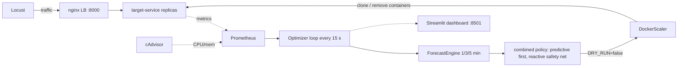

# Autonomous Cloud Resource Optimizer

Educational prototype for **predictive container scaling** using Docker Compose, Prometheus, cAdvisor, Locust, FastAPI, and Streamlit.

## What runs locally

- Target API via the nginx load balancer: `http://localhost:8000` (`/health`, `/work`). Replicas are
  not published on host ports; the load balancer discovers them through Docker DNS.
- Prometheus: `http://localhost:9090`
- cAdvisor: `http://localhost:8080` (host support dependent)
- Optimizer health/metrics: `http://localhost:8001/health`, `http://localhost:8001/metrics`
- Locust UI: `http://localhost:8089` (traffic is controlled from the dashboard; the UI shows the running load)
- Dashboard: `http://localhost:8501`

## How it works



Every 15 seconds the optimizer reads Prometheus (request rate, p95, errors, per-replica CPU, memory), forecasts
request rate 1/3/5 minutes ahead, and decides how many `target-service` replicas it needs:
predictive sizing (`ceil(forecast / (capacity x 70%))`) when a trained model gives a confident forecast, reactive
CPU/memory thresholds otherwise, with cooldown, min/max bounds and SLA-safe scale-down. With `DRY_RUN=false` it
really starts and removes replicas. Full diagrams: [`docs/architecture.md`](docs/architecture.md).

## Demo mode (one command, everything from the dashboard)

```bash
docker compose --env-file .env.demo up -d --build     # same as: make demo
```

Open **http://localhost:8501**. The **Demo control** panel at the top lets you:

- pick the traffic Locust generates: Idle, Low, Medium, High, Ramp, Spike, Burst, Traffic drop, a scripted
  **Demo script** (quiet, spike, quiet, spike), or **Training traffic**; and the work per request. No env edits, no restarts;
- switch the scaling policy live: **Reactive only**, **Predictive**, or **Auto**, to compare them on the same traffic;
- watch the forecasting model: it **retrains itself in the background** on the telemetry the optimizer collects and is hot-reloaded.
  The panel shows progress ("Collecting telemetry 40/80 rows"), then which horizons were deployed.

A trained model is only deployed if it beats the "rate stays the same" baseline on held-out rows. Until then, **Predictive**
mode uses a rate-based forecast (next-window rate = current rate), which is the "predictive" controller measured in
[`docs/benchmark.md`](docs/benchmark.md). Details and a demo-day checklist: [`docs/setup-and-testing.md`](docs/setup-and-testing.md#demo-day-checklist).

## Quick start

```bash
cp .env.example .env
docker compose up --build      # safe mode: decisions are logged, nothing is scaled
```

Then open http://localhost:8089 and press **Start** to generate load, and http://localhost:8501 for the dashboard.
For real scaling use `make demo-live`. **Step-by-step setup, every command explained, and a scenario table:
[`docs/setup-and-testing.md`](docs/setup-and-testing.md).**

If cAdvisor is unsupported on your host, keep the stack running: the optimizer falls back to `docker stats` for CPU/memory.

## Ways to run it

| Goal | Command | Needs Docker |
|---|---|---|
| Check the code | `make test` | no |
| Compare reactive vs predictive | `make benchmark` | no (simulation) |
| Demo for the TA | `make demo` (then use the dashboard panel) | yes |
| Watch decisions safely | `docker compose up --build` | yes |
| Real autoscaling | `make demo-live` | yes |
| Prove replicas get traffic | `make smoke-scale` | yes |
| Measure one replica's capacity | `make calibrate` | yes (stack running) |
| Train the forecaster | `make train` (after 30+ min of telemetry) | no (needs collected data) |
| Reset everything | `make reset` | yes |

## Workload generation

Locust profiles are selected by `LOCUST_PROFILE` in `.env`:

- `constant`
- `ramp`
- `spike`
- `burst`
- `traffic-drop`

You can also run custom Locust commands:

```bash
docker compose run --rm -e LOCUST_PROFILE=spike locust
```

Increase target load via `.env` (`WORK_INTENSITY_*_ITERATIONS`) or endpoint override:

```text
GET /work?intensity=high
GET /work?intensity=medium&iterations=2000000
```

## Scaling modes and safety

Default is safe: `DRY_RUN=true` only logs what it *would* do. For real scaling run
`make demo-live` (= `DRY_RUN=false docker compose up --build`).

| Mode | What happens with `DRY_RUN=false` |
|---|---|
| `compose` (default) | The optimizer clones the running `target-service` container through the Docker socket: same image, env, CPU/memory limits and network, with the service name as a network alias. The nginx load balancer and Prometheus (`dns_sd_configs`) discover replicas via Docker DNS. A new replica must pass `/health` before it counts. Scale-down detaches the newest replica, drains it, then removes it; the original is never removed. Clones carry the compose labels, so `docker compose down` removes them. |
| `swarm` | `service.scale(n)` on a Swarm service. |

Policy behaviour:

- **Predictive:** `replicas = ceil(forecast_peak / (RPS_PER_REPLICA_CAPACITY x TARGET_UTILIZATION))`.
  Scales down only if the forecast would still sit under `SCALE_DOWN_UTILIZATION` with one replica fewer (hysteresis).
  `PREDICTIVE_MAX_STEP` lets it add several replicas at once (default: one step).
- **Reactive safety net:** CPU thresholds on *per-replica* utilisation (aggregate cores / (replicas x limit)).
  A reactive scale-down is vetoed when a confident forecast says current capacity is needed.
- min/max replicas, cooldown, SLA-safe scale-down (missing p95 with no traffic is not treated as a breach),
  structured events in `data/runtime/scaling_events.jsonl`, fallback to reactive when the forecast is weak.

**Calibrate before demoing:** `RPS_PER_REPLICA_CAPACITY` is a measured number, not a constant.
Run `make calibrate` against one replica and put the result in `.env`.

> Status: the Docker scaling path is covered by mock-based unit tests. It has not been run against a live daemon in the environment this was written in, so do one dry rehearsal of `make demo-live` before the evaluation.

## Telemetry + runtime data schema

Optimizer writes line-delimited JSON snapshots:

- `data/runtime/telemetry_snapshots.jsonl`
  - timestamp
  - cpu_cores (aggregate cores used by all replicas)
  - cpu_usage (per-replica utilisation = cpu_cores / (replicas x REPLICA_CPU_LIMIT_CORES))
  - memory_usage
  - request_rate
  - p95_latency_ms
  - error_rate
  - replica_count
  - forecasts
  - forecast_confidence
  - estimated_cost_total
  - estimated_savings_total

And scaling events:

- `data/runtime/scaling_events.jsonl`
  - timestamp, action, from/to replicas, reason, policy, dry_run, success

## Forecasting workflow

**The optimizer retrains models automatically** (see Demo mode); the manual command below is for experiments.

Train Random Forest models (horizons 1/3/5 **minutes**, converted to rows from the sampling interval).
The target is the *change* in request rate over the horizon (`--target-mode delta`, default) or the
absolute rate (`--target-mode absolute`). Models record the interval they were trained at, and the optimizer
ignores models trained at a different sampling interval.

```bash
python -m optimizer.forecasting.train \
  --input data/runtime/telemetry_snapshots.jsonl \
  --model-dir data/models \
  --report data/processed/model_evaluation.csv
```

Outputs:

- `data/models/rf_request_rate_h*.joblib`
- `data/models/metadata.json`
- `data/processed/model_evaluation.csv` (MAE, RMSE, MAPE, R2, spike precision/recall)

Model artifacts/runtime data are gitignored.

## Reactive vs predictive benchmark

```bash
make benchmark     # simulation, no Docker needed
```

Writes `docs/results/*.csv` and plots to `docs/images/`. Results and honest caveats: [`docs/benchmark.md`](docs/benchmark.md).
Headline: on repeating bursts, predictive sizing cuts SLA-violation time ~3.3x versus reactive; the Random Forest
itself does not beat a "current rate" forecast on unseen traffic shapes.

## Dashboard capabilities

- live CPU, memory, request rate, p95 latency, error rate, replica count
- historical telemetry chart
- forecast chart (when available)
- scaling event table
- optimizer health/policy state
- estimated cost/savings
- predictive evaluation table from training report

Dashboard gracefully degrades when Prometheus/files are unavailable.

## Developer commands

```bash
make test
make train
make benchmark
make calibrate
make up
make demo-live    # real scaling
make smoke-scale  # verify replicas share traffic
make down
make reset        # down + delete Prometheus volume
```

## Testing

Unit tests cover:

- Prometheus parsing and malformed/empty data handling
- feature engineering
- persistence baseline + evaluation metrics
- reactive/predictive policy decisions
- Docker scaler: scale up/down, readiness failure, never removing the original, dry-run (mocked)
- capacity-based predictive policy, hysteresis, combined policy veto
- minute-based horizons, NaN/None telemetry handling, per-replica CPU, forecast engine and training
- benchmark determinism and calibration helper
- cost calculations
- FastAPI smoke tests

Tests do not require live Prometheus or Docker daemon.

## Troubleshooting

- Prometheus unavailable: optimizer stays degraded and retries next interval.
- Empty/malformed metric results: handled defensively; predictive policy falls back.
- No forecast models: forecast = current request rate at confidence 0.0, so the optimizer is reactive only until you run `make train` and restart it.
- Missing cAdvisor metrics: CPU/memory may be unavailable; loop still runs with fallback behavior.

## Architecture and assumptions

See:

- `docs/architecture.md` (diagrams, safety behaviour, data schema)
- `docs/setup-and-testing.md` (run and test guide)
- `docs/benchmark.md` (simulation results and caveats)
- `docs/implementation-roadmap.md`

PromQL queries assume:

- `target-service` metrics exposed by FastAPI `/metrics`
- cAdvisor compose labels (`container_label_com_docker_compose_service`)
- scrape jobs named `target-service`, `cadvisor`, and `optimizer`

## Important note on costs

Estimated cost/savings in this project are **local approximations for education only** and are **not actual cloud billing**.
