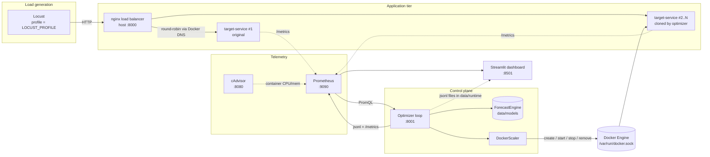
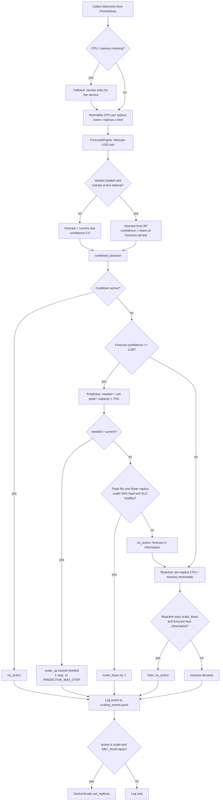
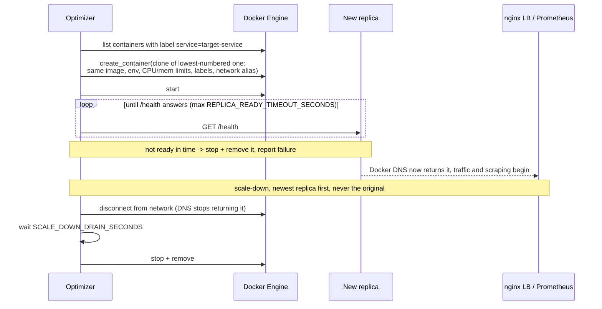

# Architecture

## System overview

Replicas are not published on host ports. nginx and Prometheus find them through Docker's embedded DNS:
every replica carries the network alias `target-service`, so the name resolves to one address per replica.

## Control loop (every `TELEMETRY_INTERVAL_SECONDS`, default 15 s)

Without trained models the confidence is 0.0, so the predictive branch is skipped and the system is
**reactive only**. Train models (see `docs/setup-and-testing.md`, step 9) to activate predictive scaling.

## How a replica is added and removed (compose mode, `DRY_RUN=false`)

## Safety and failure behaviour

- Min/max replica bounds are always enforced.
- Cooldown prevents rapid oscillation.
- Scale-down requires healthy p95 latency and error rate; a missing p95 (no traffic) is not treated as a breach.
- Scale-down hysteresis: scale up at 70% of planned capacity, scale down only if the forecast would sit under 50% with one replica fewer.
- A reactive scale-down is vetoed when a confident forecast says current capacity is needed. Reactive scale-up is never vetoed.
- Missing or malformed telemetry (including NaN/Inf) becomes `None` and yields a safe no-op or reactive fallback.
- New replicas must pass `/health` before they count; a replica that never becomes ready is discarded.
- Models trained at a different sampling interval than the optimizer's are ignored.
- `DRY_RUN=true` (default) never touches Docker.

## Data schema

### telemetry snapshots (`data/runtime/telemetry_snapshots.jsonl`)

- `timestamp`
- `cpu_cores`: aggregate cores used by all replicas
- `cpu_usage`: **per-replica** utilisation = `cpu_cores / (replicas x REPLICA_CPU_LIMIT_CORES)`
- `memory_usage`: aggregate memory used / aggregate limit
- `request_rate` (rps), `p95_latency_ms`, `error_rate`, `replica_count`
- `forecasts` (horizon minutes -> forecast rps), `forecast_confidence`
- `estimated_cost_total`, `estimated_savings_total`

### scaling events (`data/runtime/scaling_events.jsonl`)

`timestamp`, `action`, `from_replicas`, `to_replicas`, `reason`, `policy` (`reactive` / `predictive`),
`dry_run`, `success`, `forecast_confidence`, `forecasts`.

### model metadata (`data/models/metadata.json`)

`interval_seconds`, `horizons`, `target_mode` (`delta` / `absolute`), `feature_columns`, sample counts, `data_source`.

## Evaluation methodology

- Forecasting: Random Forest per horizon vs a persistence baseline ("rate stays as it is now"), reported as MAE, RMSE, MAPE, R2, and `mae_improvement_vs_baseline_pct`. Horizons are minutes, converted to rows from the sampling interval.
- Control: `optimizer/benchmark` runs the same `combined_decision` code against a simulated queueing plant on all five profiles, with the Random Forest evaluated leave-one-profile-out. Results and caveats: `docs/benchmark.md`.

## Scope limitations

- Local Compose is not a production scheduler; compose-mode scaling is container cloning through the Docker socket.
- `RPS_PER_REPLICA_CAPACITY` must be calibrated per machine (`calibrate.py`).
- The benchmark's "rate-based predictive" uses a current-rate forecast at confidence 1.0; the live optimizer without trained models has confidence 0.0 and so behaves reactively.
- The ML forecaster is not shown to beat a "current rate" forecast on unseen traffic shapes (`docs/benchmark.md`).
- cAdvisor behaviour is host-dependent (it is often incomplete on Docker Desktop); the optimizer falls back to `docker stats`.
- Estimated cost/savings are synthetic, not cloud invoices.
