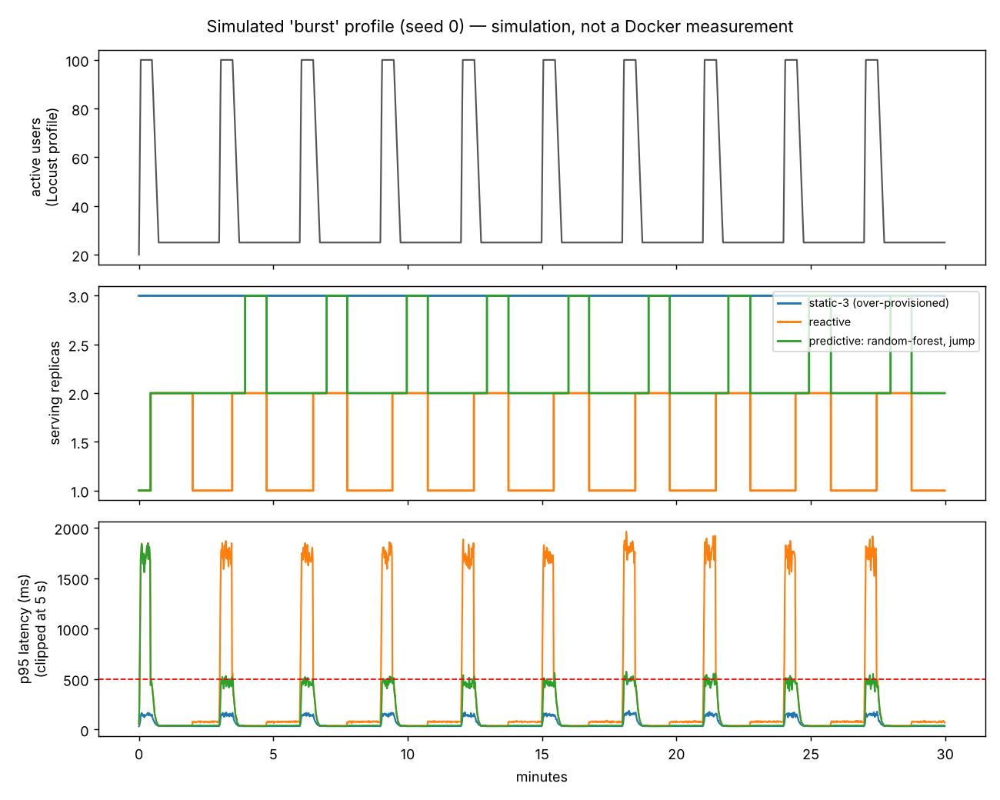
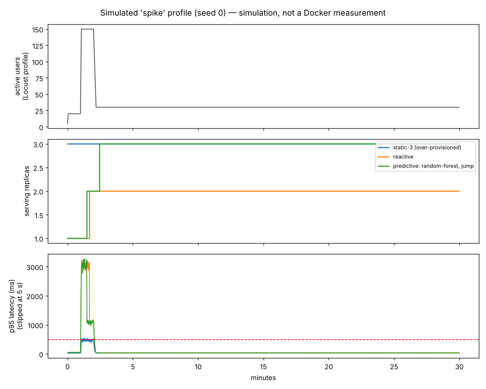

# Reactive vs predictive: benchmark

**What this is:** a closed-loop *simulation* of one replica pool under the five Locust traffic
profiles. It runs the **same decision code** as the live optimizer (`combined_decision`,
`ForecastEngine`, `train_models`), but the "cloud" is a queueing model, not Docker.
It is not a measurement of the Docker stack. Reproduce with `make benchmark`.

## Setup

| | |
|---|---|
| Plant | each replica is an M/M/1-like queue; latency `R = s0/(1-ρ)`, p95 = `3R`; load is closed-loop (Locust users wait for responses), so saturation lowers observed demand |
| True capacity | 115 rps per replica. The policy is told **90** (it plans with a safety margin, as it would after `make calibrate`) |
| Replica start-up | 12 s ± 2 s; a booting replica costs money but serves nothing |
| Telemetry | 15 s sampling; Prometheus windows emulated (rate 60 s, latency 300 s) |
| Run | 30 simulated minutes per profile, 5 seeds (mean shown) |
| SLA | p95 ≤ 500 ms; cost = replica-minutes × 0.0035 |
| Controllers | `static-3`, `static-5` (peak), `reactive` (CPU thresholds), `predictive: rate-based` (forecast = current rate, sized by capacity), `predictive: random-forest` |
| ML evaluation | **leave-one-profile-out**: the forest is trained on the *other four* profiles (6 jittered traces each) and tested on the held-out one, so it never sees the shape it is scored on |

## Results (mean of 5 seeds)

SLA-violation seconds out of 1800 / average replicas / estimated cost:

| Profile | static-3 | static-5 | reactive | predictive (rate-based, 1-step) | predictive (random forest, 1-step) |
|---|---|---|---|---|---|
| constant | 0 / 3.0 / 0.32 | 0 / 5.0 / 0.52 | **0 / 1.0 / 0.10** | 0 / 2.0 / 0.21 | 0 / 2.0 / 0.21 |
| ramp | 0 / 3.0 / 0.32 | 0 / 5.0 / 0.52 | **0 / 3.6 / 0.38** | 0 / 4.0 / 0.42 | 188 / 3.4 / 0.35 |
| spike | 13 / 3.0 / 0.32 | 0 / 5.0 / 0.52 | 63 / 1.9 / 0.20 | 63 / 2.9 / 0.30 | 63 / 2.9 / 0.30 |
| burst | 0 / 3.0 / 0.32 | 0 / 5.0 / 0.52 | 270 / 1.5 / 0.16 | **82 / 2.4 / 0.25** | 82 / 2.3 / 0.24 |
| traffic-drop | 0 / 3.0 / 0.32 | 0 / 5.0 / 0.52 | 24 / 1.2 / 0.12 | 24 / 1.3 / 0.14 | 24 / 1.3 / 0.14 |

Full table with standard deviations: `results/benchmark_summary.csv`.

## What the numbers support (and what they do not)

1. **Repeating bursts: predictive cuts SLA-violation time 3.3x versus reactive (270 s → 82 s)** and costs
   about half of static-5 (0.25 vs 0.52). It pays for this with ~1.6x reactive's replica count (0.25 vs 0.16).
   After the first burst it keeps one extra replica warm between bursts instead of releasing it, because the
   forecast (the recent rate) still needs it.
2. **Step spike: no policy helps.** 63 s of violations for reactive and predictive alike. A step change cannot be
   forecast, and a new replica needs ~12 s plus a decision interval. Only over-provisioning avoids it.
3. **Steady / ramping / falling traffic: reactive is as good or cheaper.** The predictive policy holds more
   headroom (utilisation target 70% of *planned* capacity) so it spends more for no extra benefit here.
4. **The Random Forest does not beat the "current rate" forecast on traffic shapes it has not seen.**
   Held-out MAE at 1/3/5 min averages 39 / 43 / 53 rps versus 10 / 11 / 20 for persistence, and it is worse
   on `ramp` (188 s of violations versus 0). Reasons: five distinct profiles is very little shape diversity;
   a tree ensemble cannot extrapolate beyond the rates it trained on; under saturation the observed request
   rate hides the demand. Switching the target from "future rate" to "change in rate"
   (`--target-mode delta`, now the default) roughly halved the damage on `ramp` (461 s → 188 s) but did not beat persistence.
   Every predictive gain in the table above comes from **capacity-based sizing**
   (`replicas = ceil(forecast / (capacity × 70%))`) combined with a reactive scale-down veto, not from ML.
5. **Not tested:** whether the forest does better when trained and tested on the *same* traffic pattern
   (the live setting if you replay one Locust profile repeatedly). That would be an in-distribution result and
   should be labelled as such.

## Assumptions to state when presenting

- Simulation, not a Docker measurement. Real latency curves, container start times and cAdvisor lag differ.
- The capacity (115 true / 90 planned) is an assumption chosen to be realistic for `LOCUST_WORK_INTENSITY=low`.
  Measure yours with `make calibrate` and set `RPS_PER_REPLICA_CAPACITY`.
- The traffic profiles mirror `load_testing/locustfile.py` with jitter; they are not recorded production traffic.
- Estimated cost is a unit-cost model, not cloud billing.
